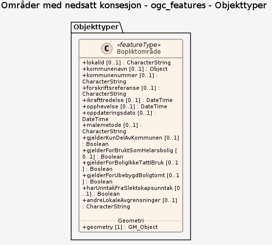
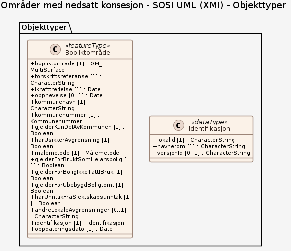

### Datamodell - ogc_features

➡️ [Se full datamodell for omfang "ogc_features" (diagram per pakke og objektkatalog)](ogc-features/objektkatalog.html)

### Datamodell - SOSI UML (XMI)

➡️ [Se full datamodell for omfang "SOSI UML (XMI)" (diagram per pakke og objektkatalog)](sosi-uml-xmi/objektkatalog.html)
